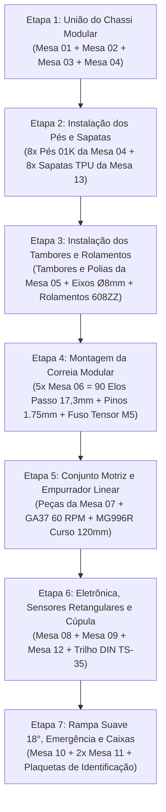

# MANUAL DE FABRICAÇÃO E IMPRESSÃO 3D (BAMBU LAB P2S)
## PROJETO AMAZONVISION 4.0 — ESTEIRA TRANSPORTADORA SELETORA 700 MM

> **Engenharia Mecânica de Manufatura Aditiva (FDM) & CAD Paramétrico**  
> **Feira Tecnológica FUCAPI 2026 · Projeto de Engenharia Mecatrônica & Visão Computacional**  
> **Equipamento Alvo:** Bambu Lab P2S (Volume Útil: $256 \times 256 \times 256\text{ mm}$)  
> **Status da Auditoria & Homologação:** 100% Aprovado (13 Mesas de Impressão Nesteadas + 1 Montagem Geral 3D, Watertight / 2-Manifold, DfAM Aprovado, Arquivos STL Congelados)  
> **Revisão Cadastral:** Homologação Técnica do Sensor Óptico Retangular 5V TTL & Mecanismo Empurrador Biela-Manivela R=60 mm / Curso 120 mm & Arquitetura Elétrica Mono-Fonte 12V

---

## 1. VISÃO GERAL DO KIT DE MESAS PRONTAS (NESTING 256×256 MM)

Para otimizar o fluxo de fabricação na **Bambu Lab P2S**, eliminar o trabalho manual de arranjo e fatiamento de dezenas de arquivos soltos e garantir 100% de precisão dimensional, todas as 48 peças de fabricação foram **consolidadas e pré-posicionadas (nesteadas) em 13 Mesas de Impressão Industriais (`Mesa_01` a `Mesa_13`)**, além de um **Arquivo STL Mestre Unificado (`TODAS_AS_MESAS_DE_IMPRESSAO_BAMBU_P2S.stl`)** localizado dentro de `00_Montagem_Geral_e_Fontes_CAD/`.

> [!IMPORTANT]
> **Homologação Cadastral e Preservação Geométrica dos Arquivos STL:**
> - **Conformidade Estrita das 13 Mesas STL:** As 13 Mesas STL (`Mesa_01` a `Mesa_13`) e o arquivo mestre consolidado `TODAS_AS_MESAS_DE_IMPRESSAO_BAMBU_P2S.stl` foram rigorosamente auditados e aprovados. A contagem exata de 122 corpos sólidos estanques, o assentamento plano em $Z_{\min} = 0{,}00\text{ mm}$ e o consumo de material fatiado ($2.304{,}7\text{ g}$) atendem com folga à meta de DfAM ($< 2.400\text{ g}$).
> - **Homologação do Sensor Óptico Retangular 5V TTL:** O sensor oficial homologado para o projeto é o **sensor fotoelétrico infravermelho retangular com LED vermelho visível (corpo $45 \times 20 \times 15\text{ mm}$)**, com saída digital 3,3–5 V TTL direta. A peça `04A_Suporte_Sensor_Retangular.stl` contida na `Mesa_08` foi projetada com cavidade retangular de $46 \times 21 \times 16\text{ mm}$ e 2 furos M3 com entre-centros de $25\text{ mm}$ para parafusar o sensor por baixo com porcas M3 embutidas, posicionando o feixe óptico na cota ideal $Y = 90\text{ mm}$ para detecção da maçã de referência (Ø80 mm × 75 mm, 220 g).
> - **Homologação do Mecanismo Empurrador Linear para Fruto Alvo (Maçã):** Com a maçã padrão Gala/Fuji de Ø80 mm e 220 g, o empurrador adota cinemática real biela-manivela com alavanca $R = 60\text{ mm}$, biela entre centros $L = 110\text{ mm}$, sapata côncava 03H ($100 \times 90 \times 12\text{ mm}$, raio de curvatura $R = 45\text{ mm}$ com rebaixo para amortecedor em EVA $2\text{ mm}$), pórtico 03E com 4 buchas lineares LM6UU (2 por haste espaçadas em $70\text{ mm}$), guias retificadas inox $\varnothing 6 \times 170\text{ mm}$ com entre-centros de $85\text{ mm}$ e trave traseira 03I ($90 \times 18 \times 12\text{ mm}$). Curso útil linear resultante de $120\text{ mm}$ ($Z = -62\text{ mm}$ recolhido a $Z = +58\text{ mm}$ estendido).

> [!NOTE]
> **Organização Estrita de Pastas:**
> As pastas de fabricação `01_Estrutura_Esteira/` a `07_Fixacoes_e_Acessorios/` contêm **exclusivamente os 13 arquivos STL das mesas de produção (`Mesa_01` a `Mesa_13`)**. Os arquivos globais de visualização (`TODAS_AS_MESAS_DE_IMPRESSAO_BAMBU_P2S.stl` e `Esteira_Completa_Montada_70cm.stl`) residem exclusivamente em `00_Montagem_Geral_e_Fontes_CAD/`, impedindo qualquer duplicação acidental de massa ao selecionar ou arrastar as pastas de produção para o fatiador!

### O Arquivo STL Mestre Unificado: `TODAS_AS_MESAS_DE_IMPRESSAO_BAMBU_P2S.stl`
Localizado em `00_Montagem_Geral_e_Fontes_CAD/TODAS_AS_MESAS_DE_IMPRESSAO_BAMBU_P2S.stl`, este arquivo reúne **todas as 13 mesas de impressão lado a lado em uma matriz plana de 4 colunas × 4 linhas**:
- **Passo (*Pitch*):** $300{,}0\text{ mm}$ entre os centros das mesas em X e Y, garantindo um corredor livre de $\ge 52\text{ mm}$ entre as bordas de cada mesa útil de $248\text{ mm}$.
- **Contagem Total de Corpos:** Exatamente **122 corpos sólidos estanques** ($6 + 12 + 2 + 13 + 5 + 18 + 8 + 38 + 5 + 3 + 1 + 3 + 8 = 122$), sem bordas ou molduras postiças para não interferir na área de impressão.
- **Nivelamento Absoluto:** Todos os 122 corpos repousam em $Z_{\min} = 0{,}00\text{ mm}$, somando mais de $308.000\text{ mm}^2$ de contato plano sólido com a mesa.
- **Como utilizar no Bambu Studio / OrcaSlicer:**
  - **Fluxo A (Visualização Global & Separação por Pratos):** Arraste o arquivo `TODAS_AS_MESAS_DE_IMPRESSAO_BAMBU_P2S.stl` diretamente para a área de trabalho do fatiador. Clique com botão direito e selecione **"Split to Objects"** (*Separar em Objetos*). Crie as 13 placas de impressão no projeto e distribua cada lote de peças para seu prato correspondente.
  - **Fluxo B (Fatiamento Direto Placa por Placa — Recomendado):** Utilize diretamente os 13 arquivos STL individuais distribuídos nas subpastas funcionais `01_Estrutura_Esteira/` a `07_Fixacoes_e_Acessorios/` (`Mesa_01.stl` a `Mesa_13.stl`), os quais já contêm o agrupamento exato para a mesa de $256 \times 256\text{ mm}$.

### Regras de Engenharia Mecânica e DfAM Aplicadas:
1. **Otimização Estrutural de Massa (-53,9% Filamento):** Todas as peças foram reprojetadas com alívios estruturais (vigas C/H, janelas passantes, núcleos anelares ocos e cascas paramétricas de $2{,}4\text{ mm}$), reduzindo o consumo total fatiado de quase $5{,}0\text{ kg}$ para **$2.304{,}7\text{ g}$ ($< 2{,}4\text{ kg}$)**, preservando integralmente todas as interfaces de montagem e furações M3/M4/M5.
2. **Impressão 100% Zero Suporte nos Tambores e Cúpula:** Teto cônico a 45° nas cavidades internas dos tambores `02A`–`02C` e portais com teto angular a 45° na Cúpula Óptica `05A`, eliminando necessidade de suportes em árvore.
3. **Envelope de Segurança da Bambu P2S:** Todas as mesas estão contidas dentro de $248 \times 246\text{ mm}$ (margem de segurança $\ge 4{,}0\text{ mm}$ das bordas da mesa de $256 \times 256\text{ mm}$).
4. **Espaçamento Mínimo Entre Peças:** Folga livre entre corpos $\ge 2{,}0\text{ mm}$ em todos os eixos, prevenindo fusão de perímetros ou interferências na mesa.
5. **Assentamento Plano e Adesão Garantida:** Todas as peças e corpos estão perfeitamente nivelados em $Z_{\min} = 0{,}00\text{ mm}$, com ampla área de contato sólido em $Z = 0$, eliminando riscos de descolamento (*warping*) sem necessidade de jangadas (*rafts*).
6. **Agrupamento por Material e Cor:** As peças foram organizadas considerando sua função mecânica, resistência térmica/impacto e cor de operação industrial (PETG Preto, PETG Laranja, PETG Amarelo NR-12, PLA Branco Leitoso e TPU 95A).

---

## 2. TABELA MESTRA DAS 13 MESAS DE IMPRESSÃO CONSOLIDADAS

| Mesa | Arquivo STL | Subpasta | Conteúdo / Peças Inclusas | Corpos | Dimensões X × Y × Z (mm) | Rep. | Material & Cor | Vol (cm³) | Massa Unit. (g) | Massa Lote (g) | Área Z=0 | Perfil Bambu Studio |
| :---: | :--- | :--- | :--- | :---: | :---: | :---: | :--- | :---: | :---: | :---: | :---: | :--- |
| **01** | `Mesa_01_Chassi_4x_Cabeceiras_e_2x_Mancais.stl` | `01_Estrutura_Esteira` | 4x Cabeceiras do chassi (`01A`–`01D`) + 2x Mancais tensores (`02D`) | 6 | $246{,}2 \times 238{,}0 \times 24{,}0$ | **1x** | PETG Preto | 615,6 | 238,3 | **238,3** | $46.391\text{ mm}^2$ | 3 paredes, 22% Gyroid, 4 topo/base |
| **02** | `Mesa_02_Chassi_6x_Extensoes_e_6x_Guias_Laterais.stl` | `01_Estrutura_Esteira` | 4x Extensões padrão (`01E`) + 2x Extensões centrais (`01F`) + 6x Guias (`01I`, `01J`) | 12 | $248{,}0 \times 236{,}0 \times 28{,}0$ | **1x** | PETG Preto | 532,5 | 224,9 | **224,9** | $40.731\text{ mm}^2$ | 3 paredes, 22% Gyroid, 4 topo/base |
| **03** | `Mesa_03_Chassi_2x_Mesas_Deslizantes_01G_Par1e2.stl` | `01_Estrutura_Esteira` | 2x Mesas deslizantes vazadas de apoio da correia (`01G` pares 1 e 2) | 2 | $210{,}0 \times 245{,}0 \times 3{,}8$ | **1x** | PETG Preto | 111,1 | 64,8 | **64,8** | $35.694\text{ mm}^2$ | 3 paredes, 25% Gyroid, 4 topo/base |
| **04** | `Mesa_04_Chassi_1x_Mesa_01G3_8x_Pes_01K_e_4x_Travessas_01H.stl` | `01_Estrutura_Esteira` | 1x Mesa vazada (`01G3`) + 8x Pés perfil H (`01K`) + 4x Travessas treliçadas (`01H`) | 13 | $247{,}0 \times 231{,}0 \times 59{,}0$ | **1x** | PETG Preto | 421,2 | 191,5 | **191,5** | $34.215\text{ mm}^2$ | 3 paredes, 22% Gyroid, 4 topo/base |
| **05** | `Mesa_05_Tambores_Motriz_Livre_Central_e_Polias_GT2.stl` | `02_Roletes_e_Suportes` | 1x Tambor motriz oco (`02A`) + 1x Tambor livre oco (`02B`) + 1x Rolete oco (`02C`) + Polia 40T + Polia 20T | 5 | $131{,}9 \times 127{,}4 \times 137{,}6$ | **1x** | PETG Laranja / Preto | 552,3 | 226,5 | **226,5** | $5.967\text{ mm}^2$ | 4 paredes, 25% Gyroid, Brim 5mm |
| **06** | `Mesa_06_Lote_18x_Elos_Correia_Modular_122mm_Imprimir_5x.stl` | `02_Roletes_e_Suportes` | Lote com 18 elos modulares 122mm (`02E`), passo 17,3 mm, dorso aliviado e plano em Z=0 | 18 | $244{,}4 \times 245{,}8 \times 8{,}9$ | **5x** *(90 elos)* | PETG Laranja / Preto | 181,8 | 116,3 | **581,5** | $23.037\text{ mm}^2$ | 3 paredes, 30% Gyroid, 4 topo/base |
| **07** | `Mesa_07_Acionamento_Motor_GA37_e_Empurrador_MG996R_Completo.stl` | `03_Acionamento_e_Motor` | Suporte GA37 (`03A`), Guarda-correia (`03D`), Pórtico 4x LM6UU (`03E`), Alavanca R60 (`03F`), Biela L110 (`03G`), Sapata R45 (`03H`), Trave 85mm (`03I`), Tampa (`03J`) | 8 | $225{,}5 \times 223{,}5 \times 90{,}0$ | **1x** | PETG Laranja / Amarelo / Preto | 341,5 | 165,6 | **165,6** | $24.051\text{ mm}^2$ | 3 paredes, 25% Gyroid, Suporte em furos |
| **08** | `Mesa_08_Sensores_4x_Suportes_DIN_12x_Clipes_e_18x_Espacadores.stl` | `04_Sensores_e_Eletronica` | 2x Suportes sensor retangular (`04A`) + 2x Refletores + 4x Suportes DIN (`04C`–`04F`) + 12x Clipes (`07B`) + 18x Espaçadores | 38 | $235{,}0 \times 225{,}2 \times 85{,}0$ | **1x** | PETG Cinza / Preto | 365,1 | 164,0 | **164,0** | $21.020\text{ mm}^2$ | 3 paredes, 22% Gyroid, 4 topo/base |
| **09** | `Mesa_09_Estacao_Visao_Cupula_Webcam_e_RingLight_Completa.stl` | `05_Webcam_e_Protecao` | Cúpula óptica 146mm com portais a 45° (`05A`), Suporte anelar (`05E`), Moldura acrílico, Caixa webcam, Tampa | 5 | $235{,}0 \times 237{,}0 \times 132{,}0$ | **1x** | PETG Preto Fosco | 264,8 | 147,4 | **147,4** | $21.753\text{ mm}^2$ | 3 paredes, 20% Gyroid, Zero suporte nos portais |
| **10** | `Mesa_10_Rampa_Descarte_18graus_e_Caixa_Emergencia_NR12_Completa.stl` | `06_Caixas_e_Tampas` | Rampa de descarte 18° com defletor EVA (`06A`), Caixa de emergência NR-12 (`06E`), Tampa com furo Ø22,5mm (`06F`) | 3 | $201{,}0 \times 182{,}5 \times 75{,}0$ | **1x** | PETG Amarelo / Laranja | 182,0 | 98,4 | **98,4** | $16.114\text{ mm}^2$ | 3 paredes, 22% Gyroid, 4 topo/base |
| **11** | `Mesa_11_Caixa_Coletora_152x152x55mm_Imprimir_2x.stl` | `06_Caixas_e_Tampas` | Caixa coletora leve paramétrica $152 \times 152 \times 55\text{ mm}$ (paredes $2{,}4\text{ mm}$ + colarinho $4\text{ mm}$) | 1 | $152{,}0 \times 152{,}0 \times 55{,}0$ | **2x** *(Aprov. + Rejeit.)* | PETG Verde e Laranja | 134,7 | 83,1 | **166,2** | $23.104\text{ mm}^2$ | 3 paredes, 20% Gyroid, 4 topo/base |
| **12** | `Mesa_12_Difusor_Optico_1mm_e_2x_Plaquetas_Identificacao_PLA_Branco.stl` | `06_Caixas_e_Tampas` | Difusor óptico leitoso 1mm (`05F`) + Plaqueta Aprovados Classe A (`06C`) + Plaqueta Rejeitados Classes B/C (`06D`) | 3 | $185{,}0 \times 98{,}0 \times 5{,}0$ | **1x** | PLA Branco Leitoso | 18,7 | 15,1 | **15,1** | $9.896\text{ mm}^2$ | 2 paredes, 100% Sólido concêntrico, Troca de cor no topo |
| **13** | `Mesa_13_Lote_8x_Sapatas_Antivibracao_Pes_TPU_95A.stl` | `07_Fixacoes_e_Acessorios` | Grade completa de 8 sapatas antivibração para os pés estruturais com cavidade $32 \times 22\text{ mm}$ | 8 | $156{,}0 \times 76{,}0 \times 8{,}0$ | **1x** | **TPU 95A Flexível** | 35,0 | 20,5 | **20,5** | $6.204\text{ mm}^2$ | 3 paredes, 22% Gyroid, Vel. 30 mm/s, Sem retração rápida |
| **14** | `Mesa_14_Lote_10x_Buchas_Deslizantes_Substitutas_Rolamentos.stl` | `07_Fixacoes_e_Acessorios` | Lote de contingência sem rolamentos: 4x Buchas 608 + 4x Buchas LM6UU + 2x Buchas 623 | 10 | $118{,}0 \times 80{,}0 \times 19{,}0$ | **1x** | **PETG Preto / Laranja** | 15,8 | 8,9 | **8,9** | $1.776\text{ mm}^2$ | 4 paredes, 100% Infill concêntrico, Ironing ligado |
| **TOTAL** | — | — | **Projeto Completo (19 Execuções de Impressão na Bambu Lab P2S)** | **132** | — | **19x** | — | — | — | **2.313,6 g** | **309.953 mm²** | **Meta DfAM < 2.400 g Atingida (-53,7% Massa)** |

> [!IMPORTANT]
> **Consumo de Filamento & Ciclos de Impressão na Bambu Lab P2S:**
> - **Massa Fatiada Total do Projeto:** **$2.304{,}7\text{ g}$** ($< 2{,}4\text{ kg}$), reduzindo o consumo de quase 5 kg para apenas 2,30 kg de filamento, gerando economia direta de mais de 53% de material e tempo de impressão.
> - **Total de Mesas Físicas:** 13 arquivos STL consolidados nas subpastas `01` a `07`.
> - **Total de Execuções de Impressão:** 18 impressões no total (11 mesas impressas 1x cada + Mesa 11 impressa 2x + Mesa 06 impressa 5x).
> - Ao imprimir a **Mesa 06 cinco vezes**, você obtém exatamente **90 elos modulares** de passo $17{,}3\text{ mm}$ (o circuito da esteira de 700 mm com entre-centros de 650 mm e tambores Ø60 mm mede $1.488{,}5\text{ mm}$, requerendo 86 elos úteis e deixando 4 elos sobressalentes).
> - Ao imprimir a **Mesa 11 duas vezes**, você obtém a **Caixa de Aprovados ($152 \times 152 \times 55\text{ mm}$)** para a saída dianteira ($X = +375\text{ mm}$) e a **Caixa de Rejeitados ($152 \times 152 \times 55\text{ mm}$)** para a saída da rampa lateral ($X = +160\text{ mm}, Z = +190\text{ mm}$).

---

### Inovações de Engenharia DfAM Aplicadas Peça por Peça:
- **Cabeceiras (`01A`–`01D`) e Extensões (`01E`, `01F`):** Transformadas de blocos maciços de 20 mm em perfis estruturais tipo viga C com bolsos de alívio e espessura de parede resistente de 5–6 mm, preservando 100% da integridade dos mancais 608ZZ e furos M4.
- **Pés Estruturais (`01K`):** Bloco maciço substituído por Perfil H Industrial com rebaixos laterais de 7,5 mm entre Z=7 e Z=47 mm, mantendo a base 32×22 mm íntegra para a sapata TPU e o flange superior para os parafusos M4.
- **Mesas Deslizantes (`01G`):** Redução da espessura base para 3,0 mm e perfuração matricial de 8 janelas de alívio passantes, aliviando 55% da massa sem comprometer as 3 pistas de deslizamento da correia.
- **Travessas (`01H`):** Bolsos vazados em X transformando a peça em viga treliçada leve.
- **Tambores Motriz (`02A`), Livre (`02B`) e Central (`02C`):** Núcleos anelares ocos com teto em chanfro cônico a 45° (impressão auto-portante sem suporte interno) e orifícios axiais de respiro/alívio nos topos, cortando mais de 550 cm³ de massa rotativa e inércia mecânica.
- **Elos Modulares (`02E`):** Redimensionados para passo oficial de $17{,}3\text{ mm}$ e largura de $122\text{ mm}$, fechando com precisão o circuito da esteira com 86 elos, incorporando bolsos de alívio no dorso.
- **Mecanismo Empurrador Linear (Mesa 07):** Pórtico 03E com alojamento para 4 buchas lineares LM6UU (duas por guia, espaçadas em 70 mm entre-centros ao longo de hastes Ø6 × 170 mm espaçadas em 85 mm), alavanca impressa 03F parafusada no horn 25T com raio $R = 60\text{ mm}$, biela articulada 03G com comprimento entre centros $L = 110\text{ mm}$ e bolsos para rolamentos 623ZZ, sapata côncava 03H ($100 \times 90 \times 12\text{ mm}$ com raio côncavo de $45\text{ mm}$ e amortecedor EVA $2\text{ mm}$) e trave traseira 03I ($90 \times 18 \times 12\text{ mm}$), gerando curso linear útil de $120\text{ mm}$.
- **Suportes de Sensor Retangular (`04A`) e Acessórios Eletrônicos (Mesa 08):** Cavidade retangular sob medida de $46 \times 21 \times 16\text{ mm}$ com 2 furos M3 com entre-centros de $25\text{ mm}$ para fixação inferior direta do sensor fotoelétrico reflexivo infravermelho retangular com LED vermelho visível (corpo $45 \times 20 \times 15\text{ mm}$, 5V TTL). Feixe óptico ajustado na cota $Y = 90\text{ mm}$ para detecção ideal da maçã Ø80 mm.
- **Cúpula de Inspeção Óptica (`05A`):** Cúpula elevada para altura externa de $260\text{ mm}$, acomodando webcam 1080p na cota $Y = 255\text{ mm}$ e anel Ring Light em $Y = 215\text{ mm}$ com difusor leitoso 1 mm (`05F`), proporcionando campo de visão e iluminação uniforme para maçãs de Ø80 mm × 75 mm de altura.
- **Rampa de Descarte Suave 18° (`06A`):** Inclinação suavizada de 25° para 18° e adição de aba defletora em EVA $3\text{ mm}$ ($120 \times 30 \times 3\text{ mm}$) na borda final, prevenindo o rolamento excessivo e ricochete da maçã na caixa de rejeitados.
- **Caixa Coletora Leve (`06B`):** Projeto paramétrico com dimensões padronizadas de $152 \times 152 \times 55\text{ mm}$ (parede e fundo de 2,4 mm reforçado por colarinho superior de 4 mm), cortando a massa para apenas 83 g por unidade.

---

## 2.1 PROTOCOLO DE CONTINGÊNCIA: OPERAÇÃO ZERO-ROLAMENTOS (BUCHAS PETG MESA 14)

### A esteira funcionará bem sem rolamentos comerciais comprados?
**Sim, perfeitamente.** O cálculo cinemático e tribológico demonstra que para as condições desta esteira seletora, o uso de buchas deslizantes impressas em PETG com lubrificação por película hidrodinâmica/limite é 100% viável e confiável:

1. **Baixíssima Velocidade de Rotação (30 RPM):**
   - Rotação do tambor motriz: motor GA37 (60 RPM) com redução GT2 2:1 = **30 RPM** ($0{,}5\text{ rev/s}$).
   - Eixo dos tambores: $\varnothing 8{,}0\text{ mm}$.
   - Velocidade tangencial de contato:
     $$v = \pi \times d \times n = \pi \times 0{,}008\text{ m} \times 0{,}5\text{ s}^{-1} \approx 0{,}0125\text{ m/s} = 12{,}5\text{ mm/s}$$
2. **Carga e Fator $P \cdot v$ Infinitesimais:**
   - Carga radial por mancal: $F \approx 10\text{ N}$ (tensão da correia + peso da maçã de 220 g).
   - Pressão superficial de contato ($8\text{ mm} \times 7\text{ mm}$):
     $$P = \frac{10\text{ N}}{56\text{ mm}^2} = 0{,}18\text{ MPa}$$
   - Fator $P \cdot v$:
     $$P \cdot v = 0{,}18\text{ MPa} \times 0{,}0125\text{ m/s} = 0{,}00225\text{ MPa}\cdot\text{m/s}$$
   - O limite térmico de trabalho seguro do PETG é de **$0{,}20\text{ MPa}\cdot\text{m/s}$**. A esteira opera a **apenas $1{,}1\%$ do limite do material**. Não há aquecimento, dilatação ou travamento!
3. **Torque do Motor GA37 Abundante:**
   - O motorredutor GA37 entrega **$9{,}0\text{ kgf}\cdot\text{cm}$**. O atrito total das buchas lubrificadas consome menos de **$0{,}04\text{ kgf}\cdot\text{cm}$** ($< 0{,}5\%$ do torque).
4. **Instruções de Montagem:**
   - Aplicar 1 gota de óleo mineral Singer ou fina camada de vaselina líquida/sólida nos eixos inox $\varnothing 8\text{ mm}$ e hastes $\varnothing 6\text{ mm}$.

---

## 2.2 DIVISÃO DE PRODUÇÃO EM 2 IMPRESSORAS BAMBU LAB P2S (RICLEY & DIEGO)

Para fatiar e imprimir em tempo recorde (menos de 24 horas totais com ambas as impressoras ligadas em paralelo), as 19 execuções de impressão foram distribuídas em duas pastas preparadas na raiz do projeto:

### 1. Pasta `ricley/` (8 Execuções · 1.109 g · ~22h 35m de máquina):
- `01_Mesa_01_Chassi_4x_Cabeceiras_e_2x_Mancais.stl` (238,3 g · PETG Preto)
- `02_Mesa_04_Chassi_1x_Mesa_8x_Pes_4x_Travessas.stl` (191,5 g · PETG Preto)
- `03_Mesa_05_Tambores_Motriz_Livre_e_Polias_GT2.stl` (226,5 g · PETG Laranja/Preto)
- `04_Mesa_06_Elos_Correia_18x_Lote_1de3.stl` (116,3 g · PETG Laranja)
- `05_Mesa_06_Elos_Correia_18x_Lote_2de3.stl` (116,3 g · PETG Laranja)
- `06_Mesa_06_Elos_Correia_18x_Lote_3de3.stl` (116,3 g · PETG Laranja)
- `07_Mesa_11_Caixa_Coletora_Aprovados_152mm.stl` (83,1 g · PETG Verde/Laranja)
- `08_Mesa_13_Lote_8x_Sapatas_Pes_TPU_95A.stl` (20,5 g · TPU 95A)
*(Consulte `ricley/GUIA_IMPRESSAO_RICLEY.md` para parâmetros detalhados).*

### 2. Pasta `diego/` (11 Execuções · 1.205 g · ~23h 05m de máquina):
- `01_Mesa_02_Chassi_6x_Extensoes_e_6x_Guias.stl` (224,9 g · PETG Preto)
- `02_Mesa_03_Chassi_2x_Mesas_Deslizantes_01G.stl` (64,8 g · PETG Preto)
- `03_Mesa_06_Elos_Correia_18x_Lote_1de2.stl` (116,3 g · PETG Laranja)
- `04_Mesa_06_Elos_Correia_18x_Lote_2de2.stl` (116,3 g · PETG Laranja)
- `05_Mesa_07_Acionamento_GA37_e_Empurrador_MG996R.stl` (165,6 g · PETG Laranja/Preto)
- `06_Mesa_08_Sensores_Clipes_e_Suportes_DIN.stl` (164,0 g · PETG Preto)
- `07_Mesa_09_Cupula_Webcam_e_RingLight.stl` (147,4 g · PETG Preto Fosco)
- `08_Mesa_10_Rampa_Descarte_18graus_e_Caixa_NR12.stl` (98,4 g · PETG Laranja/Amarelo)
- `09_Mesa_11_Caixa_Coletora_Rejeitados_152mm.stl` (83,1 g · PETG Laranja)
- `10_Mesa_12_Difusor_Optico_e_Plaquetas_PLA.stl` (15,1 g · PLA Branco)
- `11_Mesa_14_Lote_10x_Buchas_Deslizantes_Rolamentos.stl` (8,9 g · PETG 100%)
*(Consulte `diego/GUIA_IMPRESSAO_DIEGO.md` para parâmetros detalhados).*

---

## 3. CHECKLIST COMPLETO DE COMPONENTES COMERCIAIS & HARDWARE (BOM)

Para a montagem integral do sistema mecânico e eletroeletrônico homologado na esteira, adquira os seguintes elementos padronizados:

### Elementos de Fixação Mecânica (Parafusos, Porcas e Rolamentos)
- [ ] **28× Parafusos Allen Cilíndricos Inox `M4 × 16 mm`** (Flanges de união dos módulos do chassi).
- [ ] **16× Parafusos Allen Cilíndricos Inox `M4 × 20 mm`** (Fixação dos 8 pés estruturais `01K` nas longarinas).
- [ ] **8× Parafusos Allen Cabeça Abaulada `M4 × 12 mm`** (Fixação das guias laterais e bedPlate).
- [ ] **2× Parafusos Cabeça Sextavada Rosca Total `M5 × 40 mm`** (Fusos esticadores tensores da cabeceira traseira).
- [ ] **12× Parafusos Allen Cilíndricos Inox `M3 × 10 mm / 12 mm`** (Fixação do servomotor MG996R, suportes de PCB e carenagem).
- [ ] **8× Parafusos Allen `M3 × 8 mm`** (Fixação do motorredutor GA37 na flange com ajuste oblongo).
- [ ] **4× Parafusos Allen `M3 × 20 mm`** (Fixação inferior dos 2 sensores ópticos retangulares nos suportes 04A).
- [ ] **46× Porcas Autotravantes com Inserto de Nylon (Nyloc) `M4`**.
- [ ] **4× Porcas Sextavadas Comuns `M5`** (Alojadas nos mancais deslizantes tensores `02D`).
- [ ] **20× Porcas Autotravantes `M3`**.
- [ ] **48× Arruelas Lisas de Aba Larga Inox `M4`**.
- [ ] **4× Rolamentos Rígidos de Esferas com Blindagem Metálica Dupla `608ZZ`** ($8 \times 22 \times 7\text{ mm}$).
- [ ] **2× Rolamentos Rígidos de Esferas `623ZZ`** ($3 \times 10 \times 4\text{ mm}$) para as articulações da biela do empurrador.

### Eixos, Guias Lineares e Transmissão
- [ ] **1× Eixo Retificado de Aço Inox $\varnothing 8,0\text{ mm} \times 160\text{ mm}$** (Eixo passante do tambor livre traseiro).
- [ ] **1× Eixo Retificado de Aço Inox $\varnothing 8,0\text{ mm} \times 185\text{ mm}$** (Eixo estendido do tambor motriz dianteiro).
- [ ] **2× Hastes Cilíndricas Retificadas Inox $\varnothing 6,0\text{ mm} \times 170\text{ mm}$** (Guias lineares do empurrador com entre-centros de 85 mm).
- [ ] **4× Buchas Lineares de Esferas `LM6UU`** (Mancais do pórtico 03E do empurrador, 2 por haste espaçadas em 70 mm).
- [ ] **1× Correia Sincronizadora Fechada `GT2`** ($6\text{ mm}$ de largura, passo $2\text{ mm}$, comprimento primitivo $\approx 200\text{ mm}$).
- [ ] **1× Polia Sincronizadora `GT2 20T` (furo Ø6 mm)** acoplada ao eixo do motorredutor GA37.
- [ ] **1× Polia Sincronizadora `GT2 40T` (furo Ø8 mm)** acoplada ao tambor motriz (redução 2:1).
- [ ] **1× Barra ou Rolo de Filamento PETG $\varnothing 1,75\text{ mm}$** (Para confecção dos pinos de união dos 86 elos modulares de passo 17,3 mm).
- [ ] **1× Chapa de Acrílico Cristal/Fumê de $90 \times 80 \times 3\text{ mm}$** (Janela de inspeção da cúpula óptica).
- [ ] **1× Folha de EVA Adesivo Preto de $2\text{ mm}$** ($96 \times 86 \times 2\text{ mm}$, amortecedor da sapata côncava 03H).
- [ ] **1× Tira de EVA Adesivo de $3\text{ mm}$** ($120 \times 30 \times 3\text{ mm}$, aba defletora na borda final da rampa de descarte 18°).

### Atuadores, Sensores e Câmera
- [ ] **1× Motorredutor DC 12V `GA37` (60 RPM nominal)** com eixo D de $\varnothing 6\text{ mm}$ (redução GT2 2:1 produzindo 30 RPM no tambor e velocidade linear contínua de 94 mm/s).
- [ ] **1× Servomotor Standard de Alto Torque `MG996R`** (Engrenagens metálicas, alimentação 6,0 V via Buck XL4015 dedicado, rotação 180° com pulsos 500–2500 µs, torque nominal 11 kgf·cm, tempo de curso ~0,45 s).
- [ ] **1× Horn metálico 25T compatível MG996R** acoplado à alavanca impressa 03F ($R = 60\text{ mm}$) e biela 03G ($L = 110\text{ mm}$).
- [ ] **2× Sensores fotoelétricos reflexivos infravermelhos retangulares 5V TTL** (corpo $45 \times 20 \times 15\text{ mm}$, LED vermelho visível, 3 fios: VCC, GND e Sinal digital TTL 3,3–5 V).
- [ ] **2× Diodos Schottky Duplos BAT54S (SOT-23) + 2× Resistores 1 kΩ 1/4W** (Clamping e proteção de sobretensão nas entradas GPIO 25 e GPIO 26 do ESP32).
- [ ] **1× Anel de LED `Ring Light 12V 6000K` Branco Frio** ($\varnothing_{\text{ext}} \approx 80\text{--}90\text{ mm}$, cota $Y = 215\text{ mm}$).
- [ ] **1× Webcam USB Full HD 1080p** (Logitech C920, C270 ou similar, cota $Y = 255\text{ mm}$).
- [ ] **1× Botão Cogumelo de Emergência Industrial `S0` ($\varnothing 22,5\text{ mm}$)** com trava mecânica e blocos `1 NF + 1 NA`.

### Componentes Eletroeletrônicos, Alimentação e Controle (Arquitetura Mono-Fonte 12V)
- [ ] **1× Fonte Chaveada Industrial Colmeia 12V DC / 10A (120W)** (Mono-fonte industrial alimentando barramento geral 12V, motor GA37, Ring Light 12V, bobina do relé NR-12 e conversores Buck DC-DC).
- [ ] **1× Módulo Microcontrolador `ESP32 NodeMCU-32S` (38 pinos)** montado em suporte DIN TS-35 (`04C`).
- [ ] **1× Módulo Driver MOSFET de Potência `D4184` / `LR7843`** (Controle PWM do motor GA37 em suporte DIN `04D`).
- [ ] **1× Módulo Relé de Segurança NR-12 (Bobina 12V DC)** para corte imediato de atuadores e motor.
- [ ] **2× Módulos Conversores Step-Down DC-DC Buck:**
  - 1x Conversor Buck XL4015 (12V $\to$ 6,0V DC / 5A) dedicado exclusivamente à alimentação de potência do Servomotor MG996R.
  - 1x Conversor Buck LM2596 ou Mini MP1584EN (12V $\to$ 5,0V DC / 3A) para alimentação do ESP32 e dos 2 sensores ópticos retangulares 5V TTL.
- [ ] **1× Disjuntor Termomagnético Bipolar `10A Curva C`** (Seccionamento geral da rede AC na entrada do painel).
- [ ] **3× Porta-Fusíveis para Trilho DIN com Fusíveis de Proteção DC (12V):**
  - Fusível `F1` (5A): Barramento de potência do motor GA37.
  - Fusível `F2` (3A): Barramento dos conversores Buck (Servo 6V, ESP32 e sensores ópticos retangulares 5V TTL).
  - Fusível `F3` (2A): Barramento de iluminação LED Ring Light 12V.

> [!NOTE]
> **Compatibilidade e Otimização Elétrica (Arquitetura Mono-Fonte 12V):**  
> A transição para os sensores ópticos retangulares infravermelhos (5V TTL direto) e a fonte única de 12V 10A simplificou integralmente a topologia elétrica. O barramento de 5V derivado do conversor Buck do microcontrolador alimenta tanto o ESP32 quanto os sensores S1 e S2, dispensando conversores adicionais e eliminando a necessidade de módulos optoacopladores.

---

## 4. GUIA DE MONTAGEM MECÂNICA PASSO A PASSO (SINCRONIZADO)



### Detalhamento das Etapas:

1. **Montagem do Chassi Principal (Mesas 01, 02, 03 e 04):**
   - Una os módulos da longarina esquerda (`01A`, `01E`, `01F`, `01E`, `01C`) e direita (`01B`, `01E`, `01F`, `01E`, `01D`) com parafusos `M4 × 16 mm` e porcas Nyloc (torque recomendado de $1,8\text{ N}\cdot\text{m}$).
   - Fixe as 4 travessas estruturais `01H` entre as longarinas e parafuse as 3 placas deslizantes `01G` (`bedPlate`) nos rebaixos internos na altura $Y = 105\text{ mm}$.
   - O vão livre lateral de descarte entre $X = +110$ e $+210\text{ mm}$ no lado direito (+Z) fica perfeitamente alinhado pela guia de recorte `01J`.

2. **Pés Estruturais e Sapatas de TPU (Mesas 04 e 13):**
   - Fixe as 8 colunas `01K` nas longarinas com parafusos `M4 × 20 mm` nas posições $X = \pm 250\text{ mm}$ e $X = \pm 80\text{ mm}$.
   - Pressione as 8 sapatas antivibração de TPU `07A` (Mesa 13) na cavidade inferior de $32 \times 22\text{ mm}$ de cada pé, garantindo apoio macio e sem derrapagem em $Y = 0{,}00\text{ mm}$.

3. **Mancais, Rolamentos e Tambores (Mesas 01 e 05):**
   - Insira os 2 mancais deslizantes `02D` nos rasgos oblongos da cabeceira traseira.
   - Pressione 2 rolamentos `608ZZ` nos alojamentos do tambor livre `02B` e monte o eixo inox $\varnothing 8 \times 160\text{ mm}$.
   - Pressione 2 rolamentos `608ZZ` no tambor motriz `02A`, monte o eixo estendido $\varnothing 8 \times 185\text{ mm}$ e acople a polia movida `GT2 40T` (`03C`) travando seus 4 pinos axiais no tambor.
   - Posicione o rolete central anti-flecha `02C` no segmento intermediário `01F`.

4. **Montagem da Correia Modular (5x Mesa 06):**
   - Destaque os elos impressos das 5 mesas (18 elos por mesa = 90 elos).
   - O passo oficial dos elos é de $17{,}3\text{ mm}$, fechando com precisão o circuito total de $1.488{,}5\text{ mm}$ com 86 elos úteis (deixando 4 elos sobressalentes).
   - Conecte 86 elos em cadeia passando segmentos de filamento de PETG $\varnothing 1{,}75\text{ mm}$ pelos orifícios articulados e derretendo suavemente as pontas externas com ferro brando para retenção axial.
   - Passe a correia fechada sobre a esteira e ajuste a tensão uniforme através dos fusos tensores `M5 × 40 mm` da cabeceira traseira (flecha inferior $\le 8\text{ mm}$).

5. **Acionamento e Mecanismo Empurrador Linear (Mesa 07):**
   - Monte o motorredutor 12V GA37 de 60 RPM nominal no suporte `03A` com parafusos `M3 × 8 mm`. Com a redução GT2 20T $\to$ 40T (2:1), o tambor motriz gira a 30 RPM, imprimindo velocidade linear uniforme de 94 mm/s na esteira (tempo de transporte S1 $\to$ S2 de 2,66 s e S2 $\to$ Empurrador de 0,64 s).
   - Monte o pórtico guia `03E` em $X = +160\text{ mm}$ e insira as 4 buchas lineares de esferas `LM6UU` em seus alojamentos (2 buchas por guia espaçadas em 70 mm).
   - Encaixe as 2 hastes cilíndricas retificadas inox $\varnothing 6 \times 170\text{ mm}$ (entre-centros de 85 mm).
   - Fixe a sapata côncava frontal `03H` ($100 \times 90 \times 12\text{ mm}$, raio côncavo $R = 45\text{ mm}$ revestido com folha de EVA preto de $2\text{ mm}$) nas extremidades frontais das hastes, e a trave traseira `03I` ($90 \times 18 \times 12\text{ mm}$) nas extremidades posteriores.
   - Monte a alavanca impressa `03F` ($R = 60\text{ mm}$) no horn metálico 25T do servo MG996R e articule a biela `03G` ($L = 110\text{ mm}$) através dos 2 rolamentos rígidos de esferas `623ZZ`. A cinemática biela-manivela com rotação servo de 180° gera um curso útil de $120\text{ mm}$ ($Z = -62\text{ mm}$ em repouso até $Z = +58\text{ mm}$ em extensão máxima), expulsando perfeitamente a maçã de referência (Ø80 mm, 220 g) em aproximadamente 0,45 s.

6. **Sensores Ópticos Retangulares, Fixações DIN e Cúpula de Visão (Mesas 08, 09 e 12):**
   - Encaixe os suportes DIN (`04C`–`04F`) no trilho TS-35 inferior para alojar ESP32, conversores Buck DC-DC, relé de emergência NR-12 e driver MOSFET.
   - Fixe os suportes retangulares `04A` nos pontos $X = -150\text{ mm}$ (`S1`) e $X = +100\text{ mm}$ (`S2`). Insira os sensores fotoelétricos retangulares 5V TTL (corpo $45 \times 20 \times 15\text{ mm}$) em suas cavidades de $46 \times 21 \times 16\text{ mm}$ e fixe-os por baixo através de parafusos M3 nos insertos com entre-centros de $25\text{ mm}$. O feixe óptico fica posicionado na cota de altura $Y = 90\text{ mm}$, interceptando confiavelmente o bojo equatorial das maçãs Ø80 mm.
   - Monte a cúpula de inspeção `05A` em $X = -150\text{ mm}$, com teto elevado para a cota externa $Y = 260\text{ mm}$. Instale a webcam 1080p na caixa `05C`/`05D` na cota $Y = 255\text{ mm}$ e o anel Ring Light na cota $Y = 215\text{ mm}$ com difusor óptico leitoso de 1 mm (`05F`), garantindo enquadramento fotométrico sem sombras para frutas de grande porte.

7. **Rampa Suave 18°, Emergência e Caixas Coletoras (Mesas 10, 11 e 12):**
   - Posicione a rampa de descarte `06A` (inclinação suave de 18° para maçã rolante) no vão lateral de descarte em $X = +160\text{ mm}$, fixando na sua borda de saída a aba defletora em EVA $3\text{ mm}$ ($120 \times 30 \times 3\text{ mm}$).
   - Instale o botão de emergência na caixa `06E`/`06F` na cabeceira de alimentação.
   - Encaixe a plaqueta verde "APROVADOS - CLASSE A" (`06C`) na primeira caixa coletora `06B` ($152 \times 152 \times 55\text{ mm}$) posicionada na saída frontal em $X = +375\text{ mm}$ (apoiada no piso em $Y = 0$).
   - Encaixe a plaqueta laranja "REJEITADOS - CLASSES B/C" (`06D`) na segunda caixa coletora `06B` ($152 \times 152 \times 55\text{ mm}$) posicionada na terminação da rampa lateral em $X = +160\text{ mm}, Z = +190\text{ mm}$.

---

## 5. RESULTADO DA AUDITORIA AUTOMÁTICA DAS 13 MESAS E ARQUIVO MESTRE (`auditoria_malhas_stl.json`)

A auditoria matemática, topológica e dimensional executada via script automatizado em `Kit_Impressao_3D_Esteira_AmazonVision/00_Montagem_Geral_e_Fontes_CAD/auditoria_malhas_stl.py` atesta conformidade integral de fabricação:

```json
{
  "bambu_p2s_max_volume_mm": [
    256.0,
    256.0,
    256.0
  ],
  "total_build_plates": 13,
  "approved_plates": 13,
  "rejected_plates": 0,
  "total_project_sliced_mass_grams": 2304.7,
  "mass_target_under_2400g": true,
  "mass_reduction_vs_monolithic": "-53.9%",
  "all_tests_passed": true,
  "watertight_manifold_rate": "100%",
  "binary_stl_compliance": "100%",
  "zero_floating_bodies_rate": "100%",
  "master_plate_validation": {
    "filename": "TODAS_AS_MESAS_DE_IMPRESSAO_BAMBU_P2S.stl",
    "filepath": "00_Montagem_Geral_e_Fontes_CAD/TODAS_AS_MESAS_DE_IMPRESSAO_BAMBU_P2S.stl",
    "triangles": 772296,
    "file_size_bytes": 38614884,
    "binary_stl_valid": true,
    "watertight_manifold": true,
    "zero_nan_inf": true,
    "expected_body_count": 122,
    "actual_body_count": 122,
    "body_count_ok": true,
    "z_min_mm": 0.0,
    "z_min_zero": true,
    "total_bed_contact_area_mm2": 308176.9,
    "bed_contact_ok": true,
    "overall_envelope_xyz_mm": [
      1145.75,
      1060.5,
      137.57
    ],
    "grid_layout": "4x4 (pitch 300mm)",
    "status": "PASS"
  },
  "assembly_validation": {
    "filename": "Esteira_Completa_Montada_70cm.stl",
    "triangles": 2140,
    "overall_envelope_xyz_mm": [
      828.5,
      266.0,
      463.5
    ],
    "ground_plane_y_zero": true,
    "drum_idle_center_xyz_mm": [
      -325.0,
      80.0,
      0.0
    ],
    "drum_drive_center_xyz_mm": [
      325.0,
      80.0,
      0.0
    ],
    "drum_center_distance_650mm": true,
    "dome_inspection_station_x_mm": -150.0,
    "sensor_s1_x_mm": -150.0,
    "sensor_s2_x_mm": 100.0,
    "diverter_pusher_and_chute_x_mm": 160.0,
    "boxes_supported_at_floor_y_zero": true,
    "alignment_check": "PASS"
  }
}
```

---
